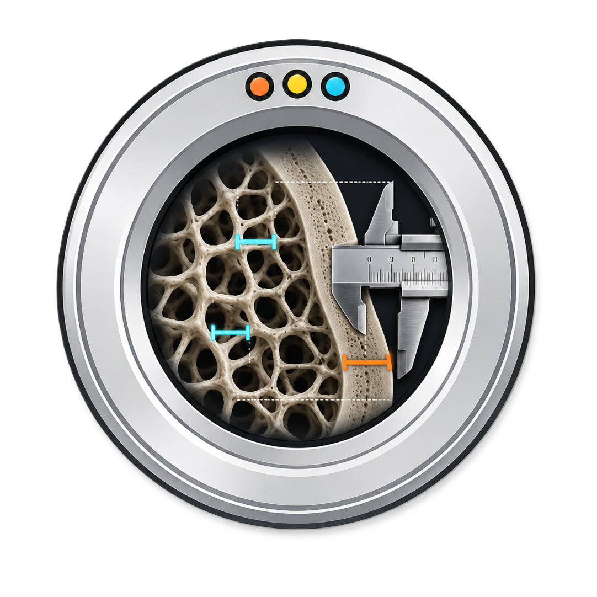

<p align="center">
  
</p>

# Bone Microarchitecture

Lightweight microarchitecture measurements from binary masks and optional calibrated grayscale arrays.

Author: Matthias Walle.

The array measurement API has no Slicer dependency and expects calibrated arrays
on a common grid. File-based batch workflows use SimpleITK (and aimio-py for AIM)
to load inputs and place cropped masks on the grayscale grid with nearest-neighbor
resampling using origin, spacing, and direction. This is grid reconciliation, not
registration; geometry-free arrays must already have the grayscale dimensions.
The grid policy participates in batch cache compatibility so older incompatible
maps are recomputed.

Batch discovery accepts canonical segmentation, periosteal, trabecular, and cortical roles from shared contour derivatives and their sidecars. See [CHANGELOG.md](CHANGELOG.md) for release notes.

## GPU Backends

Exact Hildebrand sphere fitting supports three diameter-accumulation backends:

- `cpu`: NumPy/SciPy fallback.
- `mps`: native Apple Metal backend for macOS.
- `opencl`: OpenCL backend for Windows/Linux systems with `pyopencl` and a working GPU OpenCL runtime.

Use `thickness_backend="auto"` to select Metal on macOS when available, OpenCL on Windows/Linux when available, and CPU otherwise.

Automatic OpenCL selection requires an actual GPU and a successfully compiled
kernel; a CPU OpenCL runtime is not considered GPU acceleration. Batch logs
identify the device and any CPU fallback reason before computation. CSV JSON
sidecars and map manifests record `thickness_backend`, `thickness_device`,
`thickness_gpu`, and `thickness_backend_reason`. Reused maps retain their original
backend provenance; reusing maps does not run the GPU again.

Only sphere-diameter accumulation is GPU-accelerated. Distance transforms,
ridge selection, statistics and image I/O remain on CPU. Installing
`bone-microarchitecture[gpu]` installs platform-specific Python bindings, not
the GPU manufacturer's driver/OpenCL runtime. Explicit GPU requests raise an
error when unavailable; `auto` keeps CPU-only systems usable.

Optional installs:

```bash
pip install "bone-microarchitecture[mps]"
pip install "bone-microarchitecture[opencl]"
pip install "bone-microarchitecture[gpu]"
```

## Parameter Definitions

- `Tb.BMD`: mean calibrated grayscale value inside the trabecular compartment.
- `Tb.BV/TV`: trabecular bone volume divided by trabecular total volume.
- `Tb.Th`: maximal-sphere local thickness of trabecular bone.
- `Tb.Sp`: maximal-sphere local thickness of non-bone space in the trabecular compartment.
- `Tb.N`: reciprocal of mean ridge-to-ridge spacing in the trabecular compartment (not mean reciprocal spacing).
- `Tb.1/N.SD`: standard deviation of ridge-to-ridge spacing.
- `Tb.BV`: trabecular bone volume.
- `Tb.TV`: trabecular compartment volume.
- `Ct.BMD`: mean calibrated grayscale value inside the cortical compartment.
- `Ct.Th`: maximal-sphere local thickness of the cortical compartment, including internal pores.
- `Ct.Po`: cortical pore volume divided by cortical total volume.
- `Ct.Po.V`: selected intracortical pore volume after connectivity and size cleanup.
- `Ct.Po.Dm`: maximal-sphere local diameter of the selected intracortical pores.
- `Ct.BV`: cortical bone volume.
- `Ct.TV`: cortical compartment volume.

## IPL-aligned measurement definitions

The standard method is `ipl-aligned-region-v3`, replacing the previous definitions.
It follows the supplied `IPL_UPAT_CALGARY_EVAL_XT2_NOREG.COM` evaluation recipe:

- Pore selection uses enclosed XY seeds, Z-only hysteresis growth, a second XY
  pass and removal of components smaller than five voxels. It does not classify
  every non-bone cortical voxel as a pore or close longitudinal canals at scan
  ends. The stages are described by [Burghardt et al., Bone 2010](https://pmc.ncbi.nlm.nih.gov/articles/PMC2926164/).
- `Ct.Th` uses the supplied cortical compartment, not only its mineralized phase.
  `Ct.Po = selected pore volume / cortical compartment volume`, matching the
  supplied script's denominator. `Ct.Po` is therefore not necessarily `1 - Ct.BV/Ct.TV`.
- `Tb.Sp` and ridge spacing retain the full bone-phase context before restricting
  reporting to the trabecular compartment. `Tb.N` is inverse mean spacing.
- Hildebrand fitting follows the documented IPL `suppress_boundary=2` policy:
  distances and ridges use the full input phase, then sphere centres are
  restricted to the reporting region. Spheres may extend beyond that region or
  reach an acquired image face; output is clipped to the image and reporting
  phase. No fixed slice strip is blanked. CPU, Metal and OpenCL share this policy.
  The optional `edt` preview remains a distance-transform approximation.

Pass `analysis_mask` to constrain sphere centres and reporting to a common or
Functional Bone region. Distances and ridge extraction retain full native phase
context: the ROI is not a new bone/marrow wall. Native cortical pore selection
is preserved before intersection; `Ct.Po.Mask` records it independently of diameter.

Each analysis owns its final maps. Native batch maps remain in `xct/maps/`;
common-region maps are in `xct/registered_measurements/maps/`. The file-level
`bone_microarchitecture.case.run_microarchitecture_case` helper saves Functional
Bone maps in `output_dir/maps/`. Unchanged inputs, geometry, region and settings
reuse that analysis's complete final outputs. Changed input contents or missing/
rewritten maps invalidate reuse. Distance fields are recomputed, not cached.
`restrict_measurements` remains a post-hoc reporting helper; it cannot change
sphere eligibility and is not used for common/functional-region calculations.

Results and CSV JSON sidecars record `ipl-aligned-region-v3` separately from the
package version. Batch hashes invalidate pre-alignment maps and measurements;
legacy results must be recalculated, not mixed into a new comparison. Ratios
remain fractions, not percentages. For `Tb.N`, the CSV Mean is inverse mean
spacing; its other distribution columns describe the local inverse-spacing map.

**Exact IPL parity is not validated.** The pore implementation explicitly uses
8-connectivity in XY, 26-connectivity in 3D, a 5%-of-background-area XY cutoff,
and a compact XY crop with one-voxel margin. Native IPL percentage/rank and GOBJ
boundary conventions may differ. Ridge dominance and the existing half-voxel
radius correction remain approximations, not verified translations of IPL's
`assign_epsilon`. Validation requires identical input AIM masks and native IPL
pore/ridge/diameter maps, not comparison of final scalar tables alone.
